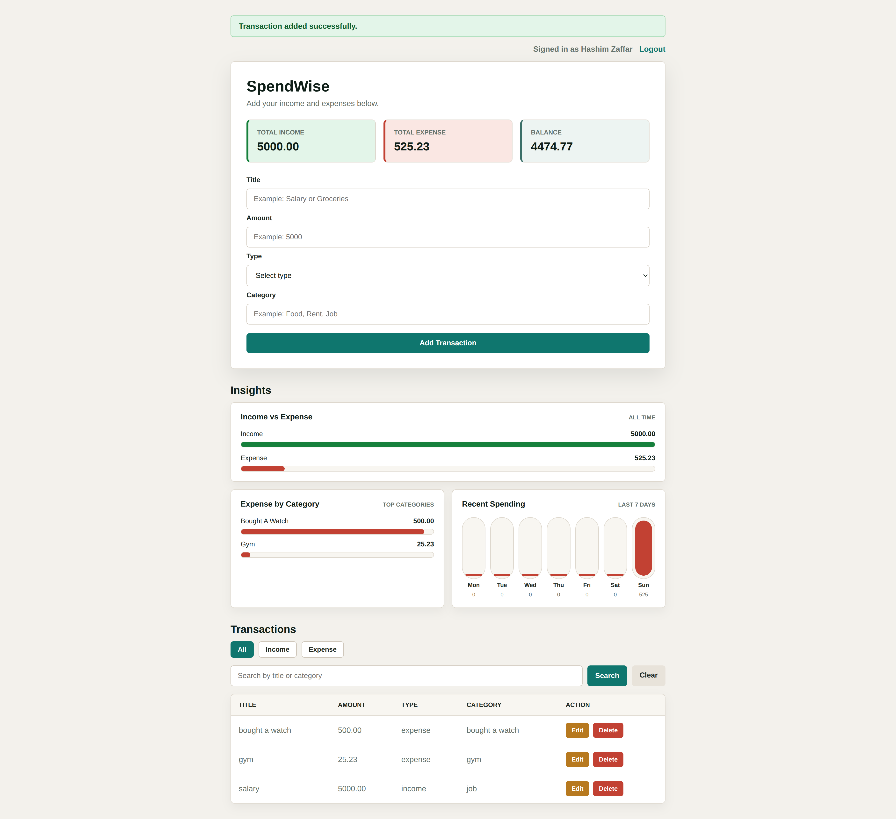
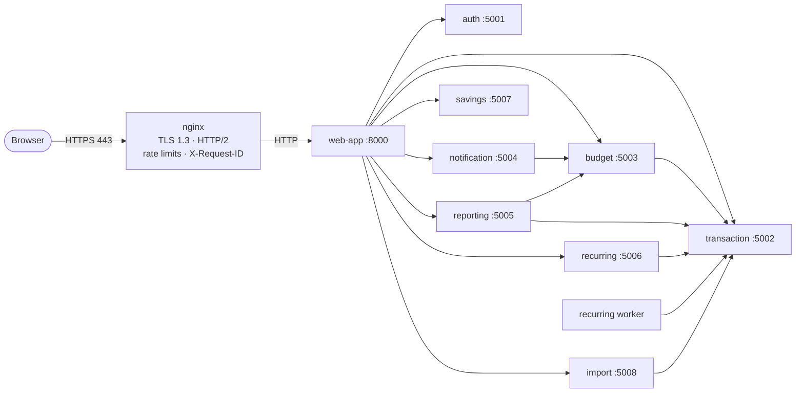

<div align="center">

# SpendWise

**A personal finance tracker built as nine Flask microservices, and a 26-week, hands-on DevOps journey that takes it from `python run.py` on a laptop to production-grade AWS.**

[](https://github.com/mhashimzaffarvirk1995-prog/SpendWise/actions/workflows/ci.yml)




</div>

---

## Table of contents

- [Overview](#overview)
- [Architecture](#architecture)
- [Tech stack](#tech-stack)
- [Quick start](#quick-start)
- [Configuration](#configuration)
- [Testing and CI](#testing-and-ci)
- [DevOps journey: week by week](#devops-journey-week-by-week)
- [Troubleshooting log highlights](#troubleshooting-log-highlights)
- [Security practices](#security-practices)
- [Repository layout](#repository-layout)
- [Documentation](#documentation)
- [Git workflow](#git-workflow)
- [Roadmap](#roadmap)
- [Application features](#application-features)

---

## Overview

**The app.** Sign up, record income and expenses, set monthly budgets per category and get alerts as you approach them, view monthly reports and export CSV, schedule recurring entries, track savings goals, and import transactions from a CSV file. Passwords are hashed, sessions use JWTs, and forms are CSRF-protected.

**The DevOps project.** The app is the workload; the real product is the platform around it. Every week adds one layer of production practice, ships it through a reviewed pull request, tags a release, and records every failure in a troubleshooting log.

| Done so far | |
|---|---|
| Cloud | AWS workbench with budgets and alerts, EC2 managed only through Session Manager (no SSH, no key pairs) |
| Linux | LVM data volume, hardened non-root systemd service, backups with a tested restore, cron, logrotate, firewall, fail2ban |
| Networking | nginx reverse proxy, Let's Encrypt TLS 1.3 with HTTP/2 and HSTS, rate limiting, end-to-end request IDs, VPC CIDR plan |
| Containers | One image per service, gunicorn, multi-stage non-root builds (**1.68 GB to about 240 MB**), private network, named volumes |
| Data | PostgreSQL with one database and one least-privilege role per service, SQLite migration, Redis report cache with instant invalidation, tested backup/restore (RTO ~10–25 s) |
| Quality gates | GitHub Actions CI, Trivy vulnerability gate, container smoke-test gate, end-to-end Compose smoke test, 32-check host verification script |
| Operations | 20+ break-and-fix drills, each written up as symptom, cause, fix and prevention |

---

## Architecture



| Port | Service | Owns database | Calls |
|---|---|---|---|
| 8000 | web-app (browser UI) | none | all services |
| 5001 | auth-service | `auth.sqlite3` | none |
| 5002 | transaction-service | `transactions.sqlite3` | none |
| 5003 | budget-service | `budgets.sqlite3` | transaction |
| 5004 | notification-service | `notifications.sqlite3` | budget |
| 5005 | reporting-service | none (stateless) | transaction, budget |
| 5006 | recurring-service + worker | `recurring.sqlite3` | transaction |
| 5007 | savings-service | `savings.sqlite3` | none |
| 5008 | import-service | `imports.sqlite3` | transaction |

Design rules:

- **Database per service.** No service reads another service's database; they talk only over HTTP APIs.
- **Stateless auth.** auth-service issues a JWT at login; every backend verifies it locally with the shared `JWT_SECRET`.
- **Traceable requests.** nginx creates an `X-Request-ID`, and every service logs and forwards it, so one ID follows a request across all hops ([walkthrough](docs/request-flow-local.md)).
- **Web and worker split.** In containers, the recurring scheduler runs as its own worker process, so scaling the API never duplicates scheduled jobs.

In Docker, every service listens on port `8080` inside its container and is reached by name on a private network (for example `http://budget-service:8080`). Only the web app is published, on `127.0.0.1:9000`.

---

## Tech stack

| Layer | Tools |
|---|---|
| Application | Python 3.12, Flask, SQLAlchemy, PyJWT, gunicorn |
| Data | PostgreSQL 17 (psycopg 3), Redis 7.4 (cache), SQLite for local runs |
| Cloud | AWS EC2 (Ubuntu 24.04), Systems Manager Session Manager, Elastic IP, Security Groups, AWS Budgets |
| Host | LVM, systemd, cron, logrotate, ufw, fail2ban, AppArmor |
| Edge | nginx, Let's Encrypt (certbot), sslip.io DNS |
| Containers | Docker CE, Docker Compose, multi-stage Dockerfile, named volumes, Amazon ECR (immutable tags, scan on push) |
| Quality and security | GitHub Actions, unittest, Trivy, smoke tests, branch protection |
| Coming next | IAM and multi-account, VPC, RDS, ECS, Terraform, Ansible, Kubernetes, Argo CD, Prometheus, Grafana |

---

## Quick start

### Option 1: Local Python (fastest)

Requires Python 3.10 or newer.

```bash
git clone https://github.com/mhashimzaffarvirk1995-prog/SpendWise.git
cd SpendWise
python3 -m venv .venv
source .venv/bin/activate
pip install -r requirements.txt
python run.py
```

Open <http://localhost:8000>. `Ctrl+C` stops all nine services. Data and auto-generated signing keys are stored in `instance/` (git-ignored).

### Option 2: Docker (one container per service)

Requires Docker. Create the env file first (see [Configuration](#configuration)), then:

```bash
scripts/docker-build.sh dev       # build 9 images, tagged "dev" and the git SHA
scripts/docker-smoke.sh dev       # gate: every image must start and report healthy
scripts/docker-scan.sh dev        # gate: fails on any CRITICAL vulnerability (Trivy)
scripts/docker-run-local.sh dev   # network + volumes + 10 containers
```

Open <http://127.0.0.1:9000>. Check status with:

```bash
docker ps --format 'table {{.Names}}\t{{.Status}}'
```

More detail in [docs/docker.md](docs/docker.md).

### Option 2b: Docker Compose with Postgres and Redis (Week 4)

The whole stack in one file: Postgres, Redis, a one-shot `db-init` job, 9 services and the recurring worker.

```bash
scripts/docker-build.sh week-04                                   # build the images
TAG=week-04 docker compose --env-file ~/spendwise-pg.env up -d    # start everything in dependency order
TAG=week-04 docker compose --env-file ~/spendwise-pg.env ps       # 12 services "healthy"
docker run --rm --network spendwise_backend -v "$PWD/scripts:/tools:ro" python:3.12-slim \
  python /tools/compose-smoke.py                                  # end-to-end check, exit 0 = pass
```

Two env files live outside the repo (mode `600`): `~/spendwise-pg.env` holds `POSTGRES_PASSWORD` and one `<SERVICE>_DB_PASSWORD` per database; `~/spendwise-docker.env` holds the app secrets and service URLs. Start order is enforced by `depends_on`: Postgres healthy → `db-init` done (roles and databases, idempotent) and Redis healthy → services healthy → web-app. Only the web app is published, on `127.0.0.1:9000`. Backup and restore: [docs/backup-restore.md](docs/backup-restore.md).

### Option 3: Server (systemd + nginx)

This is how the AWS workbench runs it today. Ready-to-install files:

| Path | What it is |
|---|---|
| [`deploy/systemd/spendwise.service`](deploy/systemd/spendwise.service) | Non-root unit with restart limits, memory caps, `UMask=0077`, and a mount dependency on the data volume |
| [`deploy/nginx/`](deploy/nginx/) | TLS site config and shared proxy snippet (headers, timeouts, request ID) |
| [`deploy/cron/spendwise`](deploy/cron/spendwise) | Nightly backup and periodic health check |
| [`deploy/logrotate/spendwise`](deploy/logrotate/spendwise) | Log rotation and compression |
| [`deploy/hardening/`](deploy/hardening/) | sshd drop-in and firewall/fail2ban setup script |
| [`scripts/healthcheck.sh`](scripts/healthcheck.sh) | Checks service, ports, disk, backups and certificate expiry; exits 1 on any failure |

---

## Configuration

Local runs need no configuration: secrets are generated on first start. For other setups, copy the example file:

```bash
cp .env.example .env
```

The Docker scripts read `~/spendwise-docker.env` (kept outside the repository, mode `600`) with:

| Variable | Purpose |
|---|---|
| `SECRET_KEY` | Flask session and CSRF signing |
| `JWT_SECRET` | Signs and verifies login tokens, shared by all services |
| `APP_ENV` | Environment name |
| `SESSION_COOKIE_SECURE` | `false` for plain HTTP on localhost, `true` behind TLS |
| `*_SERVICE_URL` | Where each service lives, for example `http://auth-service:8080` |

Never commit real secrets. `instance/` and `.env` are git-ignored.

---

## Testing and CI

```bash
pip install -r requirements.txt -r requirements-dev.txt
python -m unittest discover -s tests -v
```

[GitHub Actions](.github/workflows/ci.yml) runs the same tests on Python 3.12 for every push to a `week-*` branch and every pull request to `main`. `main` is protected, so code reaches it only through a pull request with passing checks.

Extra gates run before a release:

| Gate | Command | Fails when |
|---|---|---|
| Unit tests | `python -m unittest discover -s tests` | any test fails |
| Image scan | `scripts/docker-scan.sh <tag>` | any CRITICAL CVE in an image |
| Smoke test | `scripts/docker-smoke.sh <tag>` | any image does not become healthy |
| Host verification | `scripts/verify-week01.sh` | any of the 32 host checks fails |
| Health check | `scripts/healthcheck.sh` | service, port, disk, backup or certificate problem |

---

## DevOps journey: week by week

Each week ends with documentation, a troubleshooting log entry for every failure, a pull request, a merge and a release tag.

| Week | Theme | Tag | Status |
|---|---|---|---|
| 0 | AWS workbench and baseline | [`v0.1-baseline`](../../releases/tag/v0.1-baseline) | Done |
| 1 | Linux system administration | [`v0.2-week01`](../../releases/tag/v0.2-week01) | Done |
| 2 | Networking, TLS and Git workflow | [`v0.3-week02`](../../releases/tag/v0.3-week02) | Done |
| 3 | Docker | [`v0.4-week03`](../../releases/tag/v0.4-week03) | Done |
| 4 | PostgreSQL, Redis, Compose and ECR | [`v0.5-week04`](../../releases/tag/v0.5-week04) | Done |
| 5 | Accounts, IAM and governance | | Next |

### Week 0: AWS workbench and baseline

Goal: a safe, cheap, auditable place to work, and a clear picture of the app before changing anything.

- **Cost guardrails first.** AWS Budgets with email alerts on total credit usage and on monthly spend, so nothing surprising happens on the bill.
- **One region.** All resources in `ap-southeast-2` (Sydney), matching the organisation's service control policy.
- **EC2 without SSH.** Ubuntu 24.04 instance managed only through **Systems Manager Session Manager**: no key pair, no port 22, every session logged. The local AWS CLI uses short-lived browser login, not long-lived access keys.
- **Baseline.** The app runs locally, the architecture is documented ([architecture.md](docs/architecture.md)), and the starting point is tagged `v0.1-baseline`.

### Week 1: Linux system administration

Goal: run SpendWise on a server the way a careful admin would, then break it on purpose and fix it.

- **Storage.** App data lives on its own **LVM** logical volume (`/var/lib/spendwise`), grown online without downtime. The unit refuses to start if the volume is not mounted.
- **Least privilege.** A dedicated `spendwise` system user and code in `/opt/spendwise`. Signing keys are mode `0600` ([why](docs/week-01.md)).
- **Hardened systemd unit.** `Restart=always` with start-rate limits, `MemoryHigh`/`MemoryMax` caps, `UMask=0077`, filesystem protections and a dependency on the data mount.
- **Backups that are tested.** Nightly SQLite backups via cron ([backup.sh](scripts/backup.sh)) and a real restore test.
- **Housekeeping.** logrotate for app logs; cron jobs log their output so failures are visible.
- **Host security.** ufw firewall, hardened sshd drop-in and fail2ban.
- **Health and verification.** [healthcheck.sh](scripts/healthcheck.sh) and [verify-week01.sh](scripts/verify-week01.sh) (32 automated checks).
- **10 break-and-fix drills:** port already in use, data disk 100% full, deleted signing key, `kill -9` of one service, wrong file owner, bad `/etc/fstab` entry, memory leak and the OOM killer, crash loops and `Restart=` semantics, a cron job failing silently, and `chmod -R 777`.

### Week 2: Networking, TLS and Git workflow

Goal: put a real front door on the app and understand every hop a request takes.

- **Reverse proxy.** nginx terminates traffic on 80/443 and proxies to the app on localhost only ([config](deploy/nginx/)).
- **Stable address and real TLS.** An Elastic IP plus an `sslip.io` hostname; Let's Encrypt certificate via `certbot --webroot` with a deploy hook that reloads nginx on renewal. TLS 1.3, HTTP/2, HSTS and HTTP-to-HTTPS redirect.
- **Edge protection.** Request rate limits per client IP; the Security Group only opens 443 to known address ranges.
- **Request tracing.** nginx generates `X-Request-ID`, every service logs and forwards it ([request flow](docs/request-flow-local.md)).
- **Networking toolkit.** `curl`, `dig`, `traceroute`, `openssl s_client`, `ss` and `tcpdump`, each used to answer one concrete question ([network-tools.md](docs/network-tools.md)).
- **Cloud network design.** A VPC plan of `10.0.0.0/16` split into six `/20` subnets across availability zones ([cidr-plan.md](docs/cidr-plan.md)).
- **Git workflow.** Branch per week, protected `main`, pull requests, first [GitHub Actions](.github/workflows/ci.yml) pipeline.
- **Drills:** 502 Bad Gateway versus 504 Gateway Timeout behind nginx, plus TLS and tcpdump gotchas.

### Week 3: Docker

Goal: package every service as a small, secure, independently running container.

- **Production server.** Each service gets a `wsgi.py` and runs under **gunicorn** (`--preload`, 2 workers) instead of the Flask dev server.
- **Separate worker.** The recurring scheduler moves into its own process with a heartbeat file, so its health is checked by liveness, not by an HTTP port it does not have.
- **One multi-stage Dockerfile** for all services ([Dockerfile](services/Dockerfile)): a builder stage compiles wheels, the slim runtime stage installs them and runs as a **non-root user**, with a built-in `HEALTHCHECK`. Image size went from **1.68 GB** (naive, [Dockerfile.naive](services/Dockerfile.naive)) to **about 200 to 240 MB**.
- **Traceable images.** Every image is tagged with a name and the git SHA (`-dirty` if uncommitted changes exist) and carries the OCI `revision` label.
- **Networking and state.** A user-defined bridge network gives each container a DNS name; each stateful service gets its own named volume, so data survives container replacement.
- **Gates.** [Trivy scan](scripts/docker-scan.sh) fails the build on CRITICAL CVEs (it caught one in PyJWT, fixed by upgrading to 2.14.0). [Smoke test](scripts/docker-smoke.sh) starts each image alone and requires it to become healthy.
- **Drills:** fault isolation (one container down, the rest keep serving), OOM kill (exit code 137), `on-failure:5` crash loop, an image that builds but does not run, a worker inheriting the wrong health check, and AppArmor blocking `kill` from a confined shell.

### Week 4: PostgreSQL, Redis, Docker Compose and ECR

Goal: replace SQLite files with a real database server, add a cache, and describe the whole stack as code.

- **Postgres, one boundary per service.** Seven databases, each owned by its own login role (`auth_svc`, `budget_svc`, …) with no special powers; `CONNECT` revoked from everyone else. Created by an idempotent script (`format()` + `\gexec`), safe to run any number of times.
- **No code rewrite.** The services already used SQLAlchemy, so moving to Postgres meant adding the `psycopg` driver and changing `<SERVICE>_DATABASE_URL`.
- **Migration with proof.** A fresh backup of the live SQLite data was restored to a scratch folder, counted, migrated table by table inside each service's own image (one transaction per service, re-runnable), then counted again in Postgres: `MIGRATION COUNTS MATCH`. Integer `id` sequences are moved past the copied rows so new inserts never collide.
- **Redis report cache.** `reporting-service` caches the monthly report for 5 minutes (`X-Cache: HIT/MISS`). It **fails open**: if Redis is down, reports are still computed, and the error is logged. Partial reports are never cached.
- **Instant invalidation.** A per-user generation counter (`report-gen:{user}`) is part of the cache key; transaction and budget writes `INCR` it, so the next report is fresh at once and there is no stale-write race. Redis uses `volatile-lru` so counters are never evicted.
- **`compose.yaml`.** Healthchecks everywhere, `depends_on` with `service_healthy` / `service_completed_successfully`, memory limits, YAML anchors to avoid repetition, secrets interpolated from env files outside the repo, and only the web app published.
- **Backup and restore drill.** `pg_dump`, drop a database, recreate with `db-init`, `pg_restore`: **RTO 10–25 s**; a row written after the backup was lost (**RPO** = time since the last backup) and its id was reused. Written up in [docs/backup-restore.md](docs/backup-restore.md).
- **Amazon ECR.** Private repository with immutable tags, scan on push and a keep-last-5 lifecycle rule. EC2 pushes with its instance role through `amazon-ecr-credential-helper`, scoped by an inline policy to that one repository — no access keys anywhere.
- **Drills:** Postgres container gone after a reboot (`restart=no`, DNS name vanished), Redis down (fail open), stale cache before invalidation, overwriting an immutable tag, and an image index that ECR basic scanning cannot scan.

---

## Troubleshooting log highlights

The full log is in [docs/troubleshooting.md](docs/troubleshooting.md). Each entry follows the same format: **symptom, how it was diagnosed, root cause, fix, and how to prevent it.** A few favourites:

| Problem | Root cause | Lesson |
|---|---|---|
| Service kept restarting, then stopped for good | systemd start-rate limit reached | `Restart=always` is not infinite; tune `StartLimit*` and alert on failure |
| Data volume missing after an fstab edit | Typo in an `/etc/fstab` entry | Use `nofail` for non-root mounts and test with `mount -a` before rebooting |
| Cron job failed silently | Its output and errors went nowhere | Use absolute paths and send cron output to a log you check |
| 502 versus 504 from nginx | App down (connection refused) versus app too slow (timeout) | The status code tells you which side to look at |
| Container exited with code 137 | Kernel OOM killer at the memory limit | Set limits deliberately and watch memory before raising them |
| Scan gate failed | CRITICAL CVE in a pinned PyJWT version | Pin versions, but scan them on every build |

---

## Security practices

- No SSH keys or open SSH port; server access is through Session Manager with an audit trail.
- Short-lived AWS credentials on the workstation; no access keys in the repository or on the server.
- Secrets kept out of git (`instance/`, `.env`, `~/spendwise-docker.env` with mode `600`).
- App and containers run as non-root users; signing keys are mode `0600`; `UMask=0077` on the service.
- TLS 1.3 with HSTS; only port 80 (redirect and certificate renewal) is public, and 443 is limited to known ranges.
- Rate limiting at the edge; fail2ban and ufw on the host.
- Dependencies pinned and scanned; builds fail on CRITICAL vulnerabilities.
- `main` is protected: changes land only through pull requests with passing CI.

---

## Repository layout

```text
SpendWise/
├── services/
│   ├── <name>-service/      # app.py, wsgi.py, requirements.txt per service
│   ├── web-app/             # browser UI
│   ├── common/              # shared helpers
│   ├── Dockerfile           # one multi-stage, non-root Dockerfile for all services
│   ├── Dockerfile.naive     # the "before" image, kept for comparison
│   └── .dockerignore
├── deploy/                  # systemd, nginx, cron, logrotate, hardening
├── scripts/                 # healthcheck, backup, verify, docker build/run/smoke/scan, log-table
├── docs/                    # architecture, weekly notes, runbooks, troubleshooting log
├── tests/                   # unit tests
├── .github/workflows/ci.yml # CI pipeline
├── run.py                   # local launcher: all services in one command
└── requirements*.txt
```

---

## Documentation

| Document | What's inside |
|---|---|
| [architecture.md](docs/architecture.md) | Services, ports, databases and the call graph |
| [API.md](docs/API.md) | Backend API reference |
| [week-01.md](docs/week-01.md) | Linux notes, such as why the key file must be `0600` |
| [request-flow-local.md](docs/request-flow-local.md) | One "add transaction" request traced hop by hop |
| [network-tools.md](docs/network-tools.md) | curl, dig, traceroute, openssl, ss, tcpdump: one question each |
| [cidr-plan.md](docs/cidr-plan.md) | VPC subnet plan for AWS |
| [docker.md](docs/docker.md) | Run model, image design, tags, scans, smoke tests, proof |
| [backup-restore.md](docs/backup-restore.md) | Postgres backup and restore runbook with measured RPO/RTO |
| [troubleshooting.md](docs/troubleshooting.md) | Every failure so far: symptom, cause, fix, prevention |

---

## Git workflow

```text
week-NN branch ──► push (CI runs) ──► pull request to main ──► review + green CI ──► merge ──► tag vX.Y-weekNN
```

- One branch per week (`week-01`, `week-02`, ...).
- Commit messages follow [Conventional Commits](https://www.conventionalcommits.org/) (`feat:`, `fix:`, `docs:`, `fix(security):`).
- Tags are created on the merge commit on `main`, so every tag matches exactly what was reviewed.

---

## Roadmap

| Phase | Weeks | Topics |
|---|---|---|
| Foundations | 0 to 3 | AWS workbench, Linux, networking, TLS, Git, Docker (**done**) |
| Data and packaging | 4 | PostgreSQL, Redis, Docker Compose, migrations, backup and restore, Amazon ECR (**done**) |
| AWS core | next | IAM, VPC, RDS, ECS |
| Infrastructure as code | | Terraform, Ansible |
| CI/CD | | GitHub Actions pipelines, Jenkins |
| Kubernetes | | k3s, then EKS, Helm, Rancher |
| GitOps | | Argo CD, Flux |
| Observability | | Prometheus, Grafana, Loki, OpenTelemetry |
| DevSecOps and SRE | | Supply-chain security, SLOs, incident response |

---

## Application features

<details>
<summary><b>Budgets, notifications, reports, recurring transactions, savings, CSV import and interface</b></summary>

### Monthly budgets

The dashboard supports category budgets for any selected month. Add, edit, or delete limits, and see spending, remaining amounts, and warnings at 80% usage or when over budget. Spending uses transaction creation dates in UTC; income is excluded. Category matching ignores case and surrounding whitespace. Each user can have one budget per category per month.

`budget-service` stores limits separately in `instance/budgets.sqlite3`. It reads spending through the authenticated transaction API, without accessing the transaction database. If spending is unavailable, the dashboard shows an error rather than an incorrect zero.

Run service API checks with `.venv/bin/python -m unittest discover -s tests`.

### Notifications

The dashboard displays persistent in-app budget alerts, an unread count, and buttons to mark one or all alerts as read. Notification Service stores its own data in `instance/notifications.sqlite3` and obtains trusted spending through the authenticated Budget API.

Alerts synchronize when the dashboard opens, including after browser transaction or budget changes. API-only changes appear on the next dashboard visit or an explicit sync call. Failed synchronization is reported and retried on the next visit; saved alerts remain available. This version does not send emails or run a background queue.

Each user receives at most one near-limit and one over-limit alert per category/month. Refreshes, retries, and marking alerts read do not generate duplicates. Alerts preserve the amount at creation, even if spending later changes or the budget is removed. The list shows the latest 50 alerts; unread count includes all saved unread alerts.

### Monthly reports and CSV export

Open **Monthly Reports** from the dashboard or visit http://localhost:8000/reports. Choose a month to view income, expenses, monthly net balance, transaction count, category spending, highest spending category, and the previous month's expense change. Budget comparison is also included; if Budget Service is unavailable, transaction reporting still works with an explicit warning.

Reporting Service is stateless: it reads authenticated Transaction and Budget APIs and does not access their databases. Dates are evaluated in UTC. A percentage comparison is unavailable when prior-month expenses were zero. Monthly balance is that month's income minus expenses, rather than a carried-forward account balance.

**Download Transactions CSV** exports only the selected month's transactions for the signed-in user, with UTC dates and two-decimal amounts. Empty months export column headers. User-entered spreadsheet formula prefixes are escaped. Reports are generated on request; exports are not saved on the server. Updates in the source services appear on the next report request.

### Recurring transactions

Open **Recurring** to schedule daily, weekly, or monthly income/expenses. The launcher runs a worker every 60 seconds while the app is running, with a **Process Due Entries Now** button for immediate processing. No user access tokens are stored; the trusted worker uses the existing shared signing secret to issue short-lived user-scoped tokens for Transaction Service.

Due dates use UTC and are preserved as transaction dates. Monthly schedules retain the original day, clamping to the last day of shorter months. Paused schedules are not processed; resuming catches up missed dates. Restarting the app also catches up missed dates, with a maximum of 100 posts per cycle. Failures retain the due date for retry. Schedule UUID/date idempotency keys prevent duplicate transaction creation on retries or restarts. Deleting schedules does not delete already-posted transactions.

### Savings goals

Open **Savings Goals** to create/edit a target and optional target date. Record explicit contributions, see progress, remove mistaken contributions, or delete a goal with its contribution records. Contributions do not move money or change income/expenses; this is a tracking feature, not an automatic deduction from account balance. Request keys prevent duplicate contributions from repeated form submissions.

### CSV import

Open **Import CSV**, upload a UTF-8 file, inspect the preview, then explicitly confirm. Required columns are `date,title,type,category,amount`; SpendWise report export headers are also supported. Dates accept YYYY-MM-DD or ISO timestamps and normalize to UTC. Files are limited to 1 MB and 1000 data rows.

Every row is validated before import. If any row is invalid, fix the CSV and upload it again. Duplicate rows are skipped using UTC calendar date, case-insensitive trimmed title/category, type and amount. Existing transactions, prior imports, and repeats within a file are checked. Intentionally identical transactions on the same day are treated as duplicates by CSV import; use the normal transaction form for such entries.

Confirmation is retry-safe, including after a partial network failure. Transaction Service atomically saves an idempotency receipt with each imported/recurring transaction; receipts remain even after transaction deletion to prevent accidental recreation. Imported rows keep their original dates for monthly budgets/reports. Previews and import receipts persist in `instance/imports.sqlite3`; raw uploaded files are not stored separately. New services own their databases and use APIs to access other services' records.

### Interface

All screens share a responsive workspace layout with active navigation, accessible form labels, visible keyboard focus, and readable financial amounts. Desktop navigation uses a sidebar; smaller screens use a collapsible menu. Transactions open in a native dialog, and destructive actions prompt for confirmation. Savings and recurring editors sit alongside their records; CSV import follows upload, preview, and confirmation steps.

Design tokens and responsive components live in `services/web-app/static/style.css`. Shared Jinja layouts are in `app_base.html`, `auth_base.html`, and `ui.html`. Small enhancements in `app.js` handle dialogs, navigation focus, password visibility, message dismissal, and duplicate-submit prevention. Icons are inline SVG and no external fonts or frontend build tools are required.

</details>
