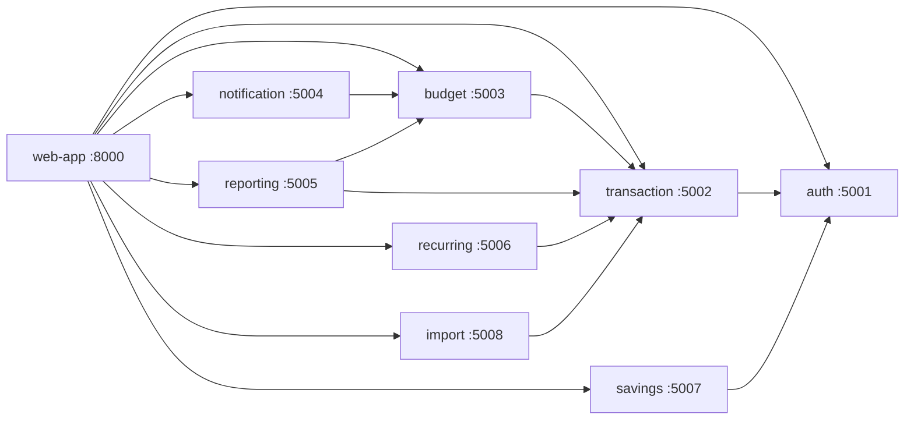

# SpendWise Architecture

SpendWise 9 Python services par mushtamil hai. Har service ki apni database hai,
aur koi service doosri ki database ko seedha nahi chhooti. Sab baat-cheet HTTP API
ke zariye hoti hai ("service-owned database" pattern).

## Services

| Port | Service              | Database               | Depends on              |
|------|----------------------|------------------------|-------------------------|
| 8000 | web-app              | —                      | all services            |
| 5001 | auth-service         | auth.sqlite3           | none                    |
| 5002 | transaction-service  | transactions.sqlite3   | auth                    |
| 5003 | budget-service       | budgets.sqlite3        | transaction API         |
| 5004 | notification-service | notifications.sqlite3  | budget API              |
| 5005 | reporting-service    | — (stateless)          | transaction + budget    |
| 5006 | recurring-service    | recurring.sqlite3      | transaction             |
| 5007 | savings-service      | savings.sqlite3        | auth                    |
| 5008 | import-service       | imports.sqlite3        | transaction             |

## Call graph

## Runtime (Week 0)

- Host: EC2 `spendwise-lab` (m7i-flex.large, Ubuntu 24.04, ap-southeast-2)
- Access: SSM Session Manager only — security group has zero inbound rules
- Browser access: SSM port forwarding (localhost:8000 → EC2:8000)
- Tests: `.venv/bin/python -m unittest discover -s tests` → 25 tests OK
